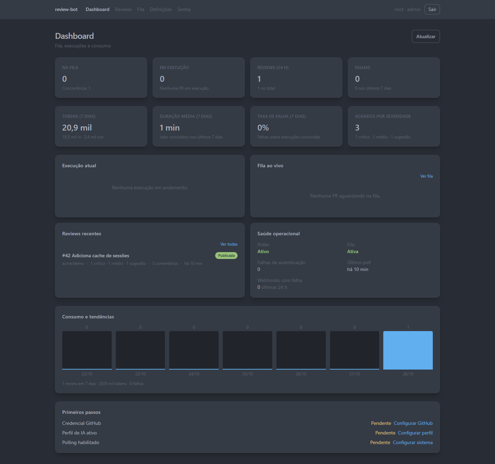
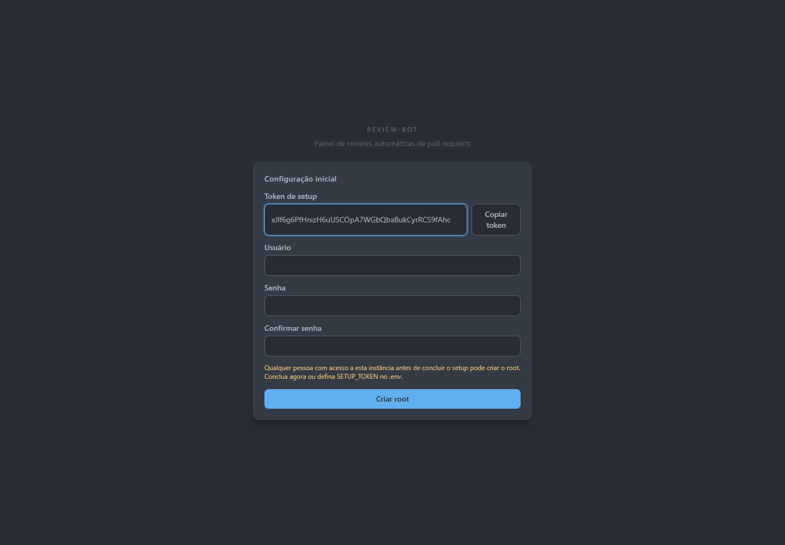
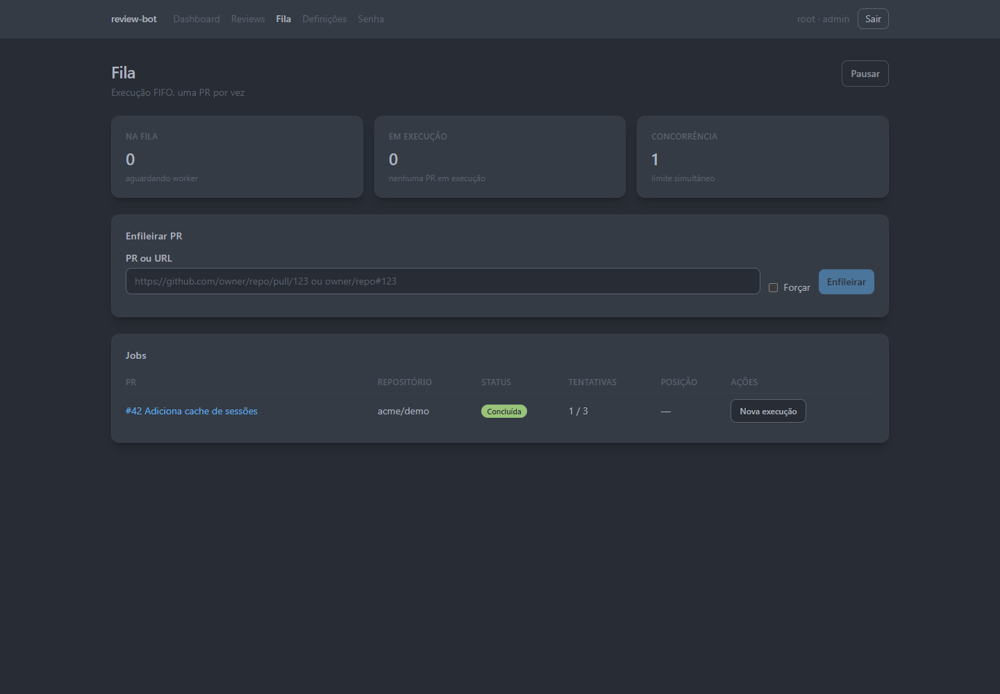
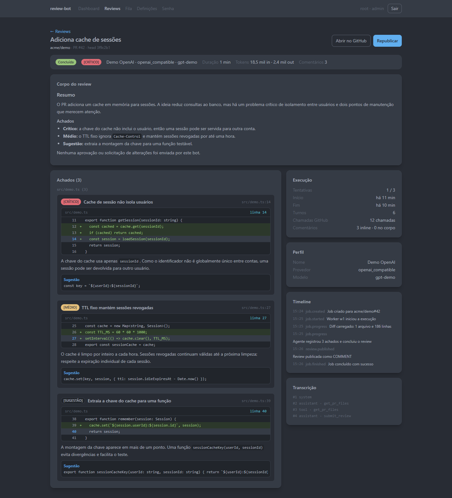
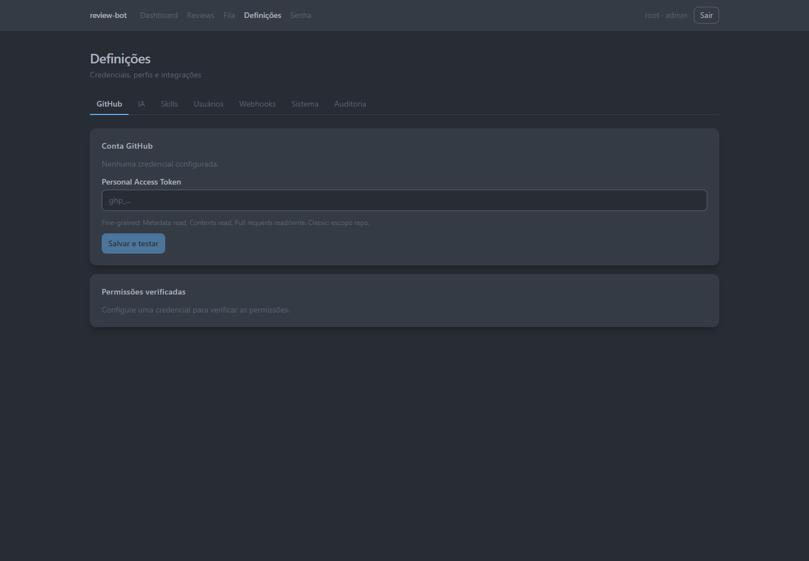

# review-bot

Painel e automação de code review de Pull Requests: o bot encontra PRs com review solicitado à conta configurada, executa um agente de IA com ferramentas somente leitura sobre o diff e publica um review com resumo e comentários inline.



## O que faz

- Consulta `is:pr is:open review-requested:@me` na conta do token GitHub por polling, sem webhook de entrada.
- Deduplica por repositório, PR e SHA; um novo commit com novo review request gera um novo job.
- Monta o contexto da PR com metadados, arquivos, patches e comentários existentes, tratando o conteúdo como não confiável contra prompt injection.
- Executa um agente com ferramentas de leitura do GitHub e valida path, linhas e duplicatas antes de publicar.
- Publica uma review `COMMENT` no commit analisado, com marcador idempotente, resumo em Markdown e comentários inline válidos. O bot nunca aprova nem solicita alterações.
- Expõe painel web com dashboard, fila, histórico, detalhe da review, eventos em tempo real por SSE, definições administrativas e auditoria.
- Persiste jobs, reviews, achados, eventos e segredos cifrados em SQLite dentro do volume `review-bot-data`.

## Requisitos

- Docker Engine com Docker Compose v2.
- Uma conta GitHub dedicada ao bot e um Personal Access Token (PAT).
- Um provedor de IA compatível com a API de chat da OpenAI ou com a API da Anthropic.
- Para desenvolvimento: Bun 1.4.2 (lockfileVersion 2) e Node.js 22 ou superior.

## Instalação rápida (release, sem git)

Baixe o zip da release, descompacte e rode o instalador. A imagem Docker já vai dentro do pacote; não é necessário clonar o repositório nem construir a imagem.

**Linux/macOS (amd64):**

```bash
curl -fL -o review-bot-amd64.zip \
  https://github.com/<owner>/review-bot/releases/latest/download/review-bot-amd64.zip
unzip review-bot-amd64.zip
cd review-bot-amd64
./install.sh
```

**Windows PowerShell (amd64):**

```powershell
Invoke-WebRequest -Uri https://github.com/<owner>/review-bot/releases/latest/download/review-bot-amd64.zip -OutFile review-bot-amd64.zip
Expand-Archive review-bot-amd64.zip -DestinationPath .
cd review-bot-amd64
.\install.ps1
```

Para arm64, troque `amd64` por `arm64`. Para uma versão específica, troque `latest` por `download/vX.Y.Z` no caminho da release. O instalador carrega o tar com `docker load`, sobe o compose e aguarda o healthcheck; depois abra `http://localhost:7080` e conclua o wizard.

> **Atenção:** qualquer pessoa com acesso à instância antes da conclusão do setup pode criar o root. Conclua o setup imediatamente. Se a instância ficará exposta publicamente antes disso, defina `SETUP_TOKEN` com pelo menos 16 caracteres e reinicie o container.

O pacote cria o volume fixo `review-bot-data` e publica a porta `${PORT:-7080}` somente em loopback (`127.0.0.1`). Para parar:

```bash
docker compose down
```

Os dados permanecem no volume `review-bot-data`; `docker compose down -v` também remove o volume.

### Instalação via GHCR (opcional)

A mesma imagem é publicada como `ghcr.io/<owner>/review-bot:<tag>`, com `latest` e a versão da tag. Se preferir puxar do registry em vez de carregar o tar, use o `docker-compose.yml` de dentro do zip:

```bash
docker compose -f docker-compose.yml up -d
```

Se o pacote for privado, autentique antes com `echo "$GHCR_TOKEN" | docker login ghcr.io -u <usuário> --password-stdin`. A instalação pelo zip não depende do GHCR nem de internet depois do download.

## Primeiro acesso

1. **Setup:** abra `/setup`. O token gerado aparece somente no campo do wizard e é invalidado ao concluir; se `SETUP_TOKEN` estiver definido, use o valor do ambiente.
2. **Root:** informe usuário e senha com 12 ou mais caracteres. A sessão é criada automaticamente.
3. **GitHub e IA:** salve o PAT e crie/ative um perfil de IA, ou use **Pular por agora** e configure depois em **Definições**.
4. **Instância:** confirme a URL pública e as opções de proxy. Ao concluir, o painel abre no dashboard; alterações de `TRUST_PROXY` exigem reiniciar o container.

Telas relacionadas: [Setup](#setup) · [Fila](#fila) · [Detalhe da review](#detalhe-da-review) · [Definições](#definições).

Depois do setup, o token não é exibido novamente. Para recuperar o acesso antes de criar o root, defina `SETUP_TOKEN`, reinicie e recarregue `/setup`. Para recuperar a senha depois do setup, consulte [Solução de problemas](#solução-de-problemas) e execute o script de reset.

## Configuração

Todas as variáveis de ambiente são opcionais. Os padrões abaixo valem sem `.env`; o Compose repassa as variáveis definidas no host ou em um `.env` local.

| Variável | Padrão | Quando definir |
|---|---|---|
| `PORT` | `7080` | Conflito de porta |
| `DATA_DIR` | `./data` (imagem: `/data`) | Volume diferente |
| `PUBLIC_URL` | `http://localhost:7080` | Proxy/TLS e cookies Secure |
| `APP_ENCRYPTION_KEY` | gerada em `DATA_DIR/.encryption-key` | Backup externo/rotação |
| `SETUP_TOKEN` | gerado no wizard | Exposição pública antes do setup |
| `TRUST_PROXY` | `false` | Atrás de proxy reverso |
| `ALLOW_PRIVATE_URLS` | `false` | Provedor/webhook em rede privada |
| `LOG_LEVEL` | `info` | Diagnóstico |
| `TZ` | `UTC` | Fuso dos logs |

`PUBLIC_URL`, `TRUST_PROXY` e `ALLOW_PRIVATE_URLS` também podem ser salvos em **Definições > Sistema** (instância). A precedência é **variável de ambiente > valor no banco > padrão**; portanto, uma variável definida no host sempre vence o valor salvo pela UI.

### Token do GitHub (PAT)

Use uma conta dedicada ao bot e solicite o review dessa conta nas PRs.

- **Fine-grained:** selecione os repositórios e conceda Metadata (read), Contents (read) e Pull requests (read/write).
- **Classic:** use o escopo `repo` para repositórios privados ou `public_repo` para apenas públicos.
- Em organizações com SSO, autorize o token para a organização.
- Salve em **Definições > GitHub** com **Salvar e testar**. A tela exibe o login e os 4 últimos caracteres do token; o valor completo é cifrado com AES-256-GCM e não retorna pela API.

### Perfis de IA

Em **Definições > IA**, crie um perfil com provedor `openai_compatible` ou `anthropic`, URL base, modelo, chave de API e limites de execução. Apenas um perfil fica ativo por vez, e cada job usa um snapshot do perfil no momento em que entra na fila. Use **Testar** para validar URL, chave e modelo.

O conteúdo da PR, o diff e os comentários são enviados ao provedor configurado. Avalie privacidade, retenção e custo antes de usar em repositórios com código restrito.

### Skills e webhooks

Skills são instruções reutilizáveis em Markdown, criadas em **Definições > Skills** e anexadas a um perfil. Cada perfil aceita até 20 skills; o pré-prompt somado às skills não pode exceder 128 KB.

Em **Definições > Webhooks**, cadastre uma URL e selecione os eventos `review.published`, `job.failed`, `job.partial` e `poller.paused`. As entregas usam HMAC-SHA256 no cabeçalho `X-PRReviewer-Signature`, com até 3 tentativas e timeout de 10 s. URLs privadas, loopback, link-local e metadados são bloqueadas por padrão; use `ALLOW_PRIVATE_URLS=true` somente em rede interna confiável.

## Onde ficam os dados

Tudo fica no volume nomeado `review-bot-data`, montado em `/data` nos dois arquivos Compose:

- `review-bot.db` (SQLite, com WAL e SHM) e migrations aplicadas no boot;
- `.encryption-key`, a chave gerada automaticamente com permissão `0600` quando `APP_ENCRYPTION_KEY` não é definida; o arquivo não existe quando a chave vem do ambiente;
- `backups/`, com os arquivos criados pelo script de backup.

A chave cifra o PAT, as chaves de IA e os secrets de webhook. Faça backup dela **separadamente** do banco. Se houver segredos cifrados e a chave estiver ausente, o container não inicia; com uma chave diferente, o banco abre, mas os segredos ficam ilegíveis. A precedência da chave é `APP_ENCRYPTION_KEY` > `DATA_DIR/.encryption-key` > chave nova gerada.

## Backup e restauração

Com o container em execução:

```bash
docker compose exec app node scripts/backup.mjs
mkdir -p backups
docker compose cp app:/data/backups/. ./backups/
```

O script usa a API de backup do SQLite e grava `review-bot-<timestamp>.db` em `/data/backups`. Copie o diretório para outro host ou storage e teste a restauração periodicamente.

A chave não deve ir dentro de `./backups`. Se a instância usa a chave em arquivo (`DATA_DIR/.encryption-key`), copie-a para um local separado:

```bash
docker compose cp app:/data/.encryption-key ./chave-encryption-key
chmod 600 ./chave-encryption-key
```

Guarde essa cópia de preferência fora do repositório. `chave-encryption-key`, `.encryption-key` e `backups/` estão no `.gitignore` e no `.dockerignore`; ainda assim, nunca inclua a chave no contexto de build nem a versione.

Se a chave vem de `APP_ENCRYPTION_KEY`, o arquivo não existe: guarde o valor em um gerenciador de segredos ou em outro local separado do backup.

Para restaurar:

```bash
docker compose stop app
docker compose run --rm --no-deps \
  -v "$(pwd)/backups:/backups:ro" \
  app sh -c 'rm -f /data/review-bot.db /data/review-bot.db-wal /data/review-bot.db-shm && cp /backups/review-bot-<timestamp>.db /data/review-bot.db'
```

Se a instância usa a chave em arquivo, restaure-a com permissão `0600`:

```bash
docker compose run --rm --no-deps \
  -v "$(pwd):/host:ro" \
  app sh -c 'cp /host/chave-encryption-key /data/.encryption-key && chmod 600 /data/.encryption-key'
```

Se a instância usa `APP_ENCRYPTION_KEY`, defina a mesma chave no ambiente; não crie o arquivo. Depois suba o container e valide:

```bash
docker compose start app
```

No PowerShell, use `${PWD}` no lugar de `$(pwd)`. O volume se chama `review-bot-data` em `docker-compose.yml` e em `docker-compose.release.yml`; confirme com `docker volume ls` antes de remover ou montar o volume manualmente.

Para inspecionar o volume sem copiar dados:

```bash
docker run --rm -v review-bot-data:/data alpine sh -c 'ls -la /data'
```

## Proxy e TLS

Não há TLS embutido. Termine o TLS no proxy reverso e mantenha o app em rede confiável:

- defina `PUBLIC_URL=https://reviews.exemplo.com` e `TRUST_PROXY=true`;
- reinicie o container para aplicar `TRUST_PROXY`;
- envie `Host`, `X-Forwarded-Proto` e `X-Forwarded-For`;
- desative buffering para o SSE `/api/events` e aumente o timeout de leitura;
- adicione HSTS após validar HTTPS, por exemplo `max-age=31536000; includeSubDomains`.

`PUBLIC_URL` é opcional; o padrão efetivo é `http://localhost:7080`. Com `https://` e `TRUST_PROXY=true`, o cookie de sessão é emitido como `Secure`.

Exemplo de bloco Nginx:

```nginx
location / {
    proxy_pass http://127.0.0.1:7080;
    proxy_http_version 1.1;
    proxy_set_header Host $host;
    proxy_set_header X-Forwarded-Proto $scheme;
    proxy_set_header X-Forwarded-For $proxy_add_x_forwarded_for;
    proxy_buffering off;
    proxy_read_timeout 3600s;
    add_header Strict-Transport-Security "max-age=31536000; includeSubDomains" always;
}
```

O Compose publica `${PORT:-7080}` somente em loopback (`127.0.0.1:${PORT:-7080}:${PORT:-7080}`) por padrão; mantenha o proxy reverso no mesmo host e exponha apenas ele. Para acesso direto pela LAN, altere o mapeamento conscientemente para `0.0.0.0:${PORT:-7080}:${PORT:-7080}` (ou o IP da interface), restrinja a porta por firewall e não exponha HTTP sem TLS. Nesse modo, o wizard de setup também fica acessível na interface liberada até a conclusão.

## Atualização

1. Faça backup do banco e guarde a chave separadamente.
2. Baixe o zip da nova versão, substitua os arquivos do diretório da instalação e rode o instalador novamente:

   ```bash
   ./install.sh
   ```

   No Windows, use `.\install.ps1`. O instalador carrega a nova imagem e preserva o volume `review-bot-data`.

3. Se você usa a instalação via GHCR, puxe a nova imagem e suba:

   ```bash
   docker compose pull
   docker compose up -d
   ```

4. Acompanhe `docker compose logs -f app` e confirme `GET /healthz`.

As migrations rodam no boot. Uma falha de migration impede o start e aparece no log; restaure o backup e use a versão correspondente. Não há downgrade automático de schema.

### Instalações do Plano 3 (volume `data` e `.env` antigo)

Instalações anteriores ao Plano 4 usavam um volume `data` prefixado pelo projeto Compose (por exemplo, `<projeto>_data`), `PORT=3000` e `APP_ENCRYPTION_KEY` no `.env`. O Plano 4 usa o volume fixo `review-bot-data` e `PORT=7080`.

1. Faça backup do banco antigo e guarde a chave (`APP_ENCRYPTION_KEY` e/ou `.encryption-key`) fora do repositório, com permissão `600` na cópia em arquivo.
2. Pare a stack antiga (`docker compose down`) e identifique o volume prefixado:

   ```bash
   docker volume ls
   ```

3. Crie o volume fixo e copie o conteúdo antigo (banco, WAL/SHM, backups e eventual `.encryption-key`):

   ```bash
   docker volume create review-bot-data
   docker run --rm \
     -v <projeto>_data:/from:ro \
     -v review-bot-data:/to \
     alpine sh -c 'cp -a /from/. /to/'
   ```

4. Mantenha o mesmo `APP_ENCRYPTION_KEY` no `.env` novo ou migre para a chave em arquivo, copiando o valor original para o volume:

   ```bash
   printf '%s' "$APP_ENCRYPTION_KEY" > chave-encryption-key
   chmod 600 chave-encryption-key
   docker run --rm \
     -v "$PWD/chave-encryption-key:/host/key:ro" \
     -v review-bot-data:/data \
     alpine sh -c 'cp /host/key /data/.encryption-key && chmod 600 /data/.encryption-key'
   ```

   No PowerShell, use `${PWD}` no lugar de `$PWD`. Se mantiver a variável de ambiente, não crie o arquivo.

5. Atualize `PORT` e `PUBLIC_URL` juntos: o padrão antigo era `3000` e o novo é `7080`. Se o proxy ainda aponta para `3000`, ou ajuste o proxy para `7080` ou defina `PORT=3000`; se `PUBLIC_URL` estava em `http://localhost:3000`, atualize para `http://localhost:7080` (ou para a URL pública HTTPS real).
6. Baixe o zip da release, extraia no diretório da instalação e rode o instalador; se preferir GHCR, use `docker compose up -d`. Depois valide login, fila, uma review recente e a publicação:

   ```bash
   ./install.sh
   docker compose logs -f app
   ```

   No Windows, use `.\install.ps1`.

O volume antigo `<projeto>_data` é deixado intacto; remova-o manualmente com `docker volume rm <projeto>_data` somente depois de validar a migração.

## Solução de problemas

- **Porta ocupada:** veja o erro em `docker compose logs app`, encerre o processo que usa `7080` ou defina `PORT=7081` no ambiente e suba de novo.
- **Volume sem permissão:** o container roda como usuário `node`. Garanta que `/data` pertença a esse usuário; prefira o volume nomeado `review-bot-data` em vez de bind mount sem ownership.
- **Chave de criptografia perdida:** se houver PAT, chaves de IA ou secrets de webhook no banco e nenhuma chave for encontrada, o container não inicia. Não há rotação automática.
  - **Modo arquivo (`DATA_DIR/.encryption-key`):** restaure a cópia guardada, com permissão `600`:

    ```bash
    chmod 600 chave-encryption-key
    docker compose run --rm --no-deps \
      -v "$(pwd):/host:ro" \
      app sh -c 'cp /host/chave-encryption-key /data/.encryption-key && chmod 600 /data/.encryption-key'
    docker compose up -d
    ```

    Se não houver cópia, gere uma chave nova e recadastre os segredos:

    ```bash
    openssl rand -base64 32 > chave-encryption-key
    chmod 600 chave-encryption-key
    docker compose run --rm --no-deps \
      -v "$(pwd):/host:ro" \
      app sh -c 'cp /host/chave-encryption-key /data/.encryption-key && chmod 600 /data/.encryption-key'
    docker compose up -d
    ```

  - **Modo ambiente (`APP_ENCRYPTION_KEY`):** restaure o valor original no `.env` ou no gerenciador de segredos. Se ele não existir mais, gere uma chave nova com `openssl rand -base64 32`, defina `APP_ENCRYPTION_KEY` no ambiente e reinicie com `docker compose up -d`.
  - Em qualquer modo, uma chave nova torna ilegíveis os segredos antigos: recadastre PAT, chaves de IA e secrets de webhook em **Definições**. Reviews, jobs e histórico continuam legíveis.
- **Token de setup:** ele aparece somente no wizard `/setup` e não é escrito no log. Se perdeu o token antes de criar o root, defina `SETUP_TOKEN` no ambiente, reinicie e recarregue a página. Se o setup já foi concluído, use o reset de senha.
- **Healthcheck:** `curl -fsS http://localhost:7080/healthz` verifica processo e SQLite; `/readyz` informa também a pausa da fila. O Compose testa a cada 30 s, com 3 tentativas.
- **Logs:** `docker compose logs -f app` mostra migrations, polling, jobs e retenção. Aumente `LOG_LEVEL=debug` temporariamente para diagnóstico.
- **Setup já concluído:** a tela informa que o setup terminou. Use `/login`; para recuperar a senha, execute `docker compose exec app node scripts/reset-password.mjs <username>`.

## Desenvolvimento

Requisitos: Bun 1.4.2 (runtime Node.js 22 ou superior).

```bash
bun install --frozen-lockfile
bun run dev        # API em http://localhost:7080
bun run dev:web    # SPA em http://localhost:5173 com proxy para a API
bun run test       # Vitest (unitários, integração e web)
bun run typecheck
bun run lint
bun run build      # gera dist/web e dist/server/server.js
bun run start      # inicia o build de produção
bun run e2e        # Playwright com Chrome do sistema
```

Para dados de demonstração e capturas, use um `DATA_DIR` temporário e descartável:

```bash
export DATA_DIR="$(mktemp -d)"
bunx tsx scripts/seed-demo.ts
PORT=7080 bun run start
```

Em outro terminal, com o servidor em execução:

```bash
BASE_URL=http://localhost:7080 DEMO_USER=root DEMO_PASSWORD=senha-muito-segura node scripts/capture-screenshots.mjs
```

O seed cria o repositório `acme/demo`, o job e a review de demonstração com três achados; ele é idempotente e não remove dados existentes. O script de captura usa `BASE_URL` (padrão `http://localhost:7080`), `DEMO_USER`, `DEMO_PASSWORD`, `DEMO_REVIEW_ID` (padrão `demo-review`), `DEMO_SETUP_TOKEN` e `PLAYWRIGHT_CHANNEL` (padrão `chrome`).

O script de captura exige uma instância limpa (`needsSetup:true`), completa o wizard e **cria o usuário root** com `DEMO_USER`/`DEMO_PASSWORD`; ele aborta se a instância já estiver configurada. Se `SETUP_TOKEN` estiver definido no servidor, informe o mesmo valor em `DEMO_SETUP_TOKEN`. Ao terminar, pare o servidor e remova o diretório temporário.

O E2E usa o Chrome instalado no sistema. Se ele não estiver disponível, instale o Chromium e sobrescreva o canal:

```bash
bunx playwright install chromium
PLAYWRIGHT_CHANNEL=chromium bun run e2e
```

## Telas

### Setup



O wizard é exibido apenas em instalação limpa. O token fica visível somente nesta etapa.

### Fila



A fila mostra jobs em execução, aguardando e concluídos, com pausa, cancelamento, reprocessamento e nova execução.

### Detalhe da review



O detalhe apresenta o corpo publicado, achados com trecho do diff, sugestões, consumo, timeline e transcrição.

### Definições



As definições administrativas concentram credenciais, perfis, skills, usuários, webhooks, sistema e auditoria.

## Segurança

- **Chave de criptografia:** gerada automaticamente em `DATA_DIR/.encryption-key` (0600) ou fornecida por `APP_ENCRYPTION_KEY`. Guarde-a separada dos backups e nunca a versione no Git.
- **Segredos no banco:** PAT, chaves de IA e secrets de webhook usam AES-256-GCM. A API não retorna os valores; os logs têm redaction para campos conhecidos. Trate logs e backups como dados sensíveis.
- **SSRF:** por padrão, provedores e webhooks não podem apontar para loopback, rede privada, link-local ou metadados. `ALLOW_PRIVATE_URLS=true` libera esses destinos e deve ser usado apenas em rede interna confiável. A revalidação de redirecionamentos existe, mas o pinning do endereço validado não faz parte da v1: DNS rebinding (TOCTOU) em webhooks permanece risco residual aceito.
- **Rede e sessão:** use HTTPS/HSTS no proxy e mantenha `PUBLIC_URL`/`TRUST_PROXY` coerentes. Senhas usam Argon2id, o token de setup é de uso único e o root não pode ser removido.
- **Permissões:** `viewer` só lê, `operator` opera a fila e `admin` gerencia configurações. O último administrador ativo não pode ser removido.

## Limitações da v1

- Gatilho apenas por polling; não há webhooks de entrada do GitHub, menção ou comando em comentários.
- O bot não clona o repositório, não executa testes, não usa git/shell e não altera arquivos.
- Nunca envia `APPROVE` nem `REQUEST_CHANGES`; publica apenas reviews `COMMENT`.
- Uma conta GitHub e uma instalação por vez; sem múltiplas réplicas ou workers distribuídos.
- Sem 2FA no painel, notificações por e-mail, app mobile, i18n ou cálculo de custo/orçamento.
- Sem integração com Prometheus/Grafana; observabilidade por logs, eventos, dashboard e webhooks.
- O aceite final em VPS com repositório de teste, PAT real e provedor de baixo custo é manual e deve ser registrado no checklist de `docs/operations.md`.

## Documentação

- [`docs/operations.md`](docs/operations.md): arquitetura de processo, fluxo do job, operação, backup, release, runbook de falhas e checklist AC-01..AC-13.
- [`docs/superpowers/specs/2026-10-22-pr-review-agent-design.md`](docs/superpowers/specs/2026-10-22-pr-review-agent-design.md): especificação funcional.
